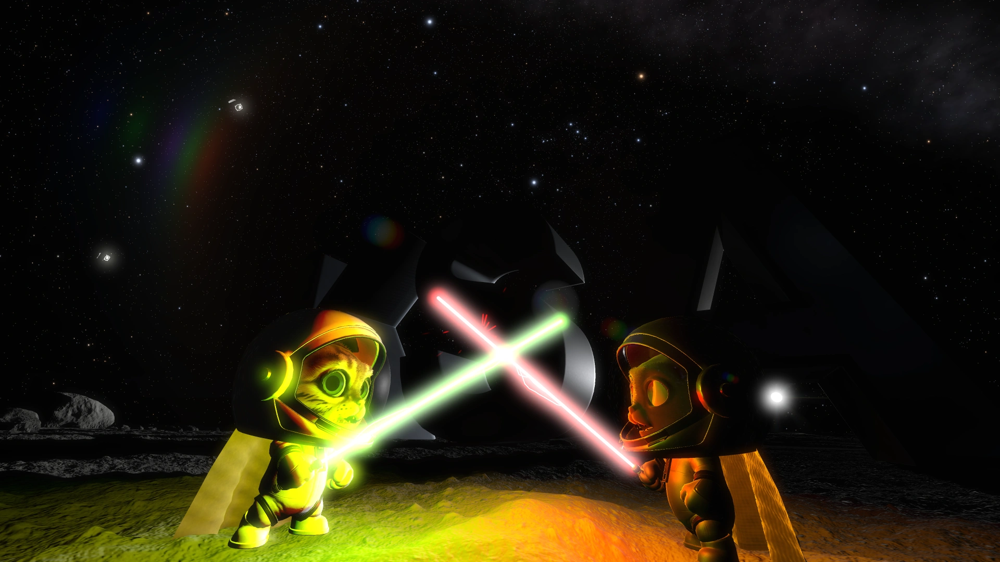
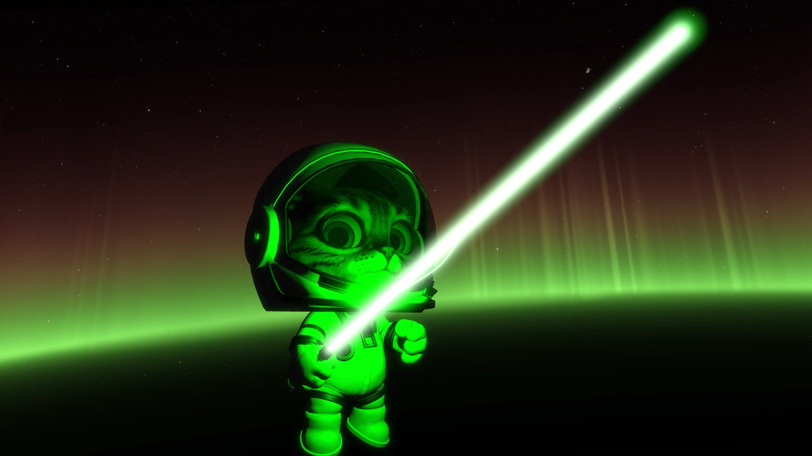
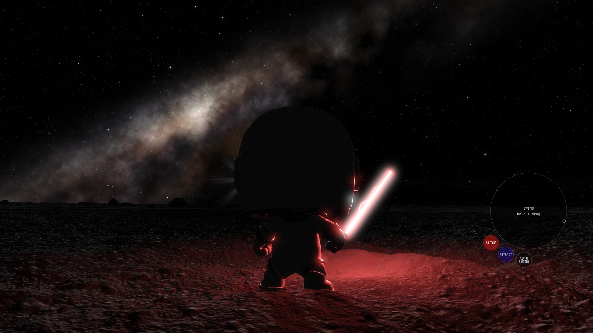
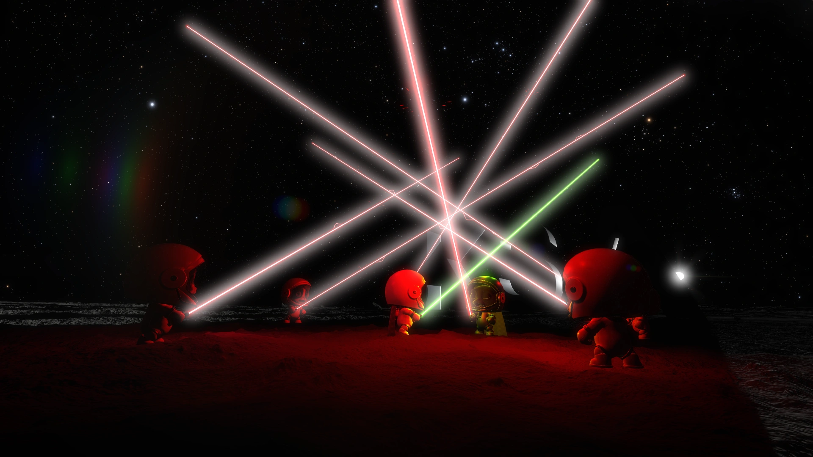
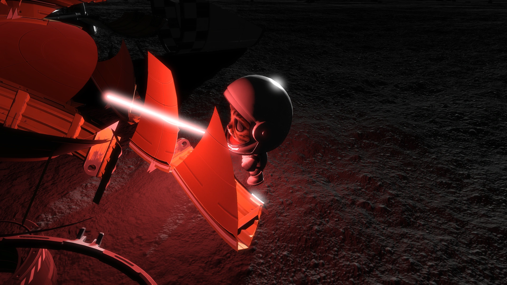
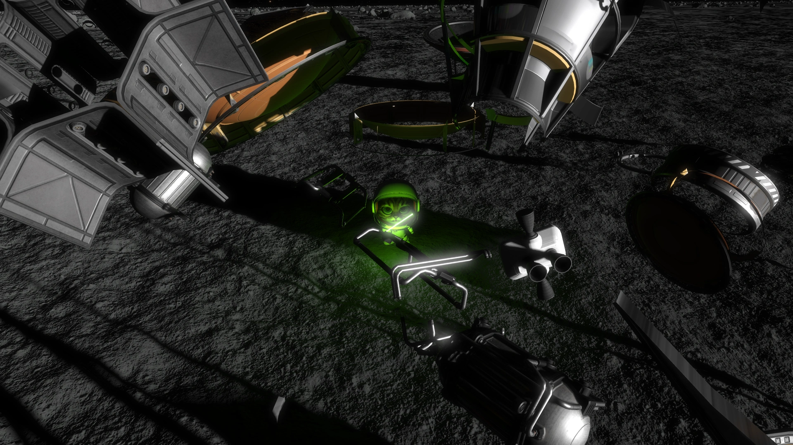

# purr2d2

A Kitten Spacy Agency mod to add:

- BFL9K (Big Fucking Laser 9000)
- The Furce

BFL9K's **DROP** button opens a downward spin pill while held. Each press starts
at **0×** spin; halfway is the previous **1×** release rate and the bottom is **2×**.
Release to reach out with an open, palm-down paw and drop the hilt into native
physics. A tap drops with no initial spin. A lit blade stays lit. **UNDROP** flies
it back from its current position, easing to a stop in the paw. Saving, unequipping or disabling
the mod also returns transient dropped equipment to its owner. Blade length can
be set up to **50 m** before character scaling.

Sabers and capes follow the kitten's observed visual scale, including per-axis
scaling, without an unscience dependency. Manual blade contact remains active
while jumping, somersaulting, swimming or underwater. Water does not extinguish
the blade. Ocean views apply water attenuation at the blade's own distance while
solid objects still block it; the glowing blade does not reproduce water's
refraction distortion.

Moving blades and assisted selection can cut ground rocks and compatible tree
meshes into physical fragments. Unsupported foliage retains its native appearance
and is felled as a whole tree. Rock cut faces cool from a glow; successfully split
tree ends burn for **10 seconds** by default. Adjust or disable that fire under
**Settings → Clutter Slicing**.

# media

